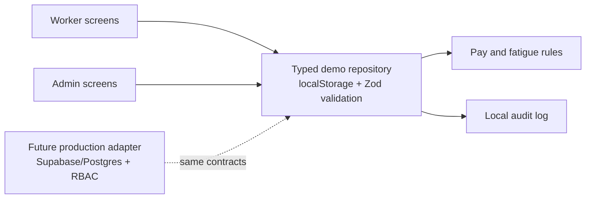

# FairShift engineering report

## Repository audit

FairShift is a Next.js 15 App Router application written in TypeScript. It uses Tailwind CSS, Lucide icons, Zod, and Vitest. It has a Cloud Run-compatible Dockerfile and no configured external backend or identity provider.

The original project had a strong responsive presentation and seeded content, but attendance, safety, and administrative views were separate mock screens. There was no session provider, server API, database migration, persistent action history, or connected worker/admin workflow.

## Implemented in this iteration

- A typed, Zod-validated browser demo repository that persists scenario data in `localStorage` and writes a local audit trail.
- Connected attendance: check-in/check-out updates the worker shift UI, worker directory, dashboard attendance metric, and audit history.
- Connected safety workflow: a worker submits a validated report; it receives an ID, appears in the worker report list and admin command center, and staff can assign, progress, or resolve it with a required resolution note.
- Privacy boundary in the administrative incident view: anonymous reporter identity is stripped before rendering. The UI never shows an anonymous reporter name.
- Decimal-safe pay primitives, using integer paise for calculations and INR formatting.
- Clearer demo disclosures: local browser persistence is never described as centrally confirmed attendance or payroll.

## Architecture

The current deployment is deliberately a **demo-mode modular client application**. It persists only in the browser that performs the action. It is not a substitute for server-side authorization, QR signing, encrypted file storage, or organization isolation.

## Route inventory

| Area | Routes | Purpose |
| --- | --- | --- |
| Public | `/`, `/login`, `/about`, `/privacy` | Product overview, demo entry, disclosures |
| Worker | `/worker/dashboard`, `/shift`, `/pay`, `/safety`, `/feedback`, `/skills`, `/profile` | Attendance, pay, safety, worker voice and credentials |
| Admin | `/admin/dashboard`, `/workers`, `/safety`, `/insights`, `/pay-queries`, `/audit`, `/settings` | Operations, privacy-safe incident handling, audit trace and policy controls |

## Preserved functionality

The Apple-inspired responsive light visual system, high contrast/reduced motion fallbacks, demo role entry points, safety categories, pay explanation, fatigue content, portable skill passport, Dockerfile, and Cloud Run deployment instructions remain in place.

## Production dependency plan

1. Add a Supabase or PostgreSQL adapter with migration-controlled organization, membership, attendance, pay rule, incident, feedback, credential, and audit tables.
2. Move every role check and mutation to authenticated route handlers; use RLS or equivalent organization scoping.
3. Integrate an approved auth provider for password recovery and verified phone/email onboarding.
4. Add signed expiring QR records, server-generated timestamps, idempotency keys, incident attachment storage, rate limits, and retry-safe queues.
5. Add Playwright end-to-end tests across production adapters before claiming multi-user synchronization or Cloud Run verification.

## Verification

- `npm run test` — pay, fatigue, and anonymous-identity unit coverage.
- `npm run build` — production bundle check.
- Local HTTP checks cover landing, worker dashboard/pay/safety, and admin dashboard/workers/safety routes.

## Current limitations

- Browser-local demo state only; data is not shared between browsers, users, or Cloud Run instances.
- Demo sign-in is not authentication and must not be used for real worker data.
- QR scanning, downloads, speech recognition, image attachment, actual translations, emails/OTP, and payments remain intentionally simulated or browser-dependent.
- No external deployment has been made or claimed.
