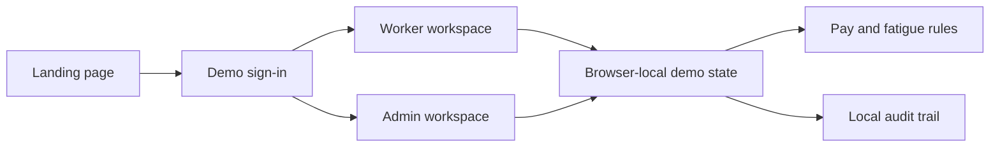

# FairShift

**FairShift is a mobile-first workforce clarity prototype for frontline teams.** It makes a worker’s shift, estimated pay, safety voice, rest signals, feedback, and skills easy to understand, while giving operations teams a separate, privacy-aware workspace to act on the same demo scenario.

The project is designed around the intent of **UN Sustainable Development Goal 8: Decent Work and Economic Growth**. It is a hackathon prototype—not a payroll, safety, identity, or HR system—and uses only synthetic data.

## Why FairShift

Frontline workers often need answers in the moment: *Where should I be? Am I checked in? How is my pay estimate calculated? Can I report a hazard safely?* Operations teams need a complementary view: attendance context, safety follow-up, unresolved work signals, and a trace of decisions.

FairShift keeps those jobs distinct:

| Workspace | Designed for | Primary outcome |
| --- | --- | --- |
| Worker app | Construction and support staff | A clear daily work plan and a safer way to speak up |
| Admin workspace | Workforce, safety, and operations teams | Earlier, privacy-aware follow-up on workforce signals |

## What is included

### Worker workspace

- Check in and check out of the day’s scheduled shift.
- Review an explained, estimated payslip with recorded hours and overtime.
- Submit named or anonymous safety reports using a guided form.
- See a daily plan, pay snapshot, rest-time prompt, quick actions, and latest safety-report status on one dashboard.
- Give anonymous-by-default feedback and view a portable skill passport.
- Use short labels and browser text-to-speech support where available.

### Admin workspace

- Review workforce, attendance, safety, and fair-work signals.
- Follow up on incoming safety reports without exposing an anonymous reporter identity.
- Assign, progress, and resolve demo incidents with a local audit trail.
- Explore workers, insights, pay queries, rules, and audit records through a dedicated desktop-friendly navigation model.

### Experience and accessibility

- Responsive layouts for compact phone widths through desktop workspaces.
- A light visual system built from semantic CSS tokens, a restrained violet action colour, warm yellow attention states, and high-contrast ink surfaces.
- Keyboard-visible focus states, labeled icon controls, readable system-font stacks, reduced-motion support, and an increased-contrast treatment.
- One clear primary action per task area; secondary workflows are presented as descriptive links rather than competing buttons.

## Product flow



The worker and admin routes use the same in-browser demo repository. For example, a worker safety report appears in the admin safety flow within that same browser profile. This is deliberate prototype behavior, not multi-user synchronization.

## Screens and routes

| Route | Purpose |
| --- | --- |
| `/` | Product landing page and role entry points |
| `/login` | Worker or admin demo sign-in |
| `/worker/dashboard` | Day plan, attendance, pay snapshot, rest prompt, and quick actions |
| `/worker/shift` | Attendance and scheduled-shift workflow |
| `/worker/pay` | Explained estimated pay breakdown |
| `/worker/safety` | Safety report submission and status list |
| `/worker/feedback` | Anonymous-by-default worker feedback |
| `/worker/skills` | Portable skill passport |
| `/admin/dashboard` | Workforce and operations overview |
| `/admin/safety` | Privacy-aware safety follow-up |
| `/admin/workers`, `/admin/insights`, `/admin/pay-queries`, `/admin/audit`, `/admin/settings` | Supporting admin workflows |

## Technology

- **Framework:** Next.js 15 App Router with React 19 and TypeScript
- **UI:** CSS custom properties, Tailwind CSS foundations, Lucide icons
- **Validation:** Zod schemas for the demo data layer
- **Testing:** Vitest for pay, fatigue, and anonymous-identity rules
- **Delivery:** Dockerfile prepared for a Cloud Run-style container deployment

```text
app/                 Route-level product surfaces
components/          Shared shell, state provider, and safety form
lib/                 Seed data and domain rules
ENGINEERING_REPORT.md  Detailed prototype and production-adapter notes
```

## Run locally

### Prerequisites

- Node.js 20 or newer
- npm 10 or newer

### Install and start

```bash
npm install
npm run dev
```

Open [http://localhost:3000](http://localhost:3000).

For a production-mode local check:

```bash
npm run build
npm run start
```

`npm run start` listens on `0.0.0.0`; it uses `PORT` when provided and otherwise starts Next.js on its default port.

## Demo entry points

Use either role switch on the sign-in screen. The scenario is seeded with fictional workers and an admin profile. No password is checked, and no real identity is created.

- **Worker:** Asha Kumar, Construction Helper
- **Worker:** Ravi Kumar, Hospital Attendant
- **Admin:** Priya Sharma

All names, worksites, pay amounts, and incident records are fabricated for demonstration purposes.

## Security and privacy controls

This prototype deliberately keeps sensitive functionality out of the browser-only demo while still applying sensible client and deployment safeguards:

- **Strict response headers:** Content Security Policy, anti-clickjacking, MIME-sniffing, referrer, cross-origin, and permissions controls are applied to every route through `next.config.ts`.
- **No secrets in client state:** The demo has no server secret, payment credential, biometric record, or real worker record. `.env` files remain ignored by Git.
- **Bounded local demo state:** Persisted browser data is size-limited and validated with strict Zod schemas before it can re-enter the app state.
- **Privacy-minimised triage:** Administrator report cards receive an identity-stripped version of each report; anonymous reporting is not a visual-only promise.
- **Explicit prototype boundary:** Demo login is not authentication, and local actions are never presented as approved payroll, verified attendance, or legal advice.

These controls improve the prototype’s safety posture; they do not replace server-side authentication, authorization, encryption, audit retention, or a formal threat model for a production deployment.

## Quality checks

Run these before proposing a deployment:

```bash
npm run test
npm run build
npm run quality
```

| Check | What it protects |
| --- | --- |
| `npm run test` | Pay/fatigue rules and the anonymous-report privacy boundary |
| `npm run build` | Type checking and a production Next.js bundle |
| `npm run quality` | Strict TypeScript check, unit suite, and production bundle in one command |
| Manual local check | Compact worker screens, landing page, and admin safety workflow |

## Container deployment

The included `Dockerfile` builds a Node 20 Alpine image and exposes port `8080`. A typical Cloud Run deployment is:

```bash
gcloud builds submit --tag gcr.io/PROJECT_ID/fairshift
gcloud run deploy fairshift \
  --image gcr.io/PROJECT_ID/fairshift \
  --platform managed \
  --region asia-south1 \
  --allow-unauthenticated
```

Replace `PROJECT_ID` and review the access policy for your environment. This command deploys a static/demo experience only; it does **not** add authentication, a shared database, or production worker-data safeguards.

## Prototype data and privacy boundary

FairShift currently stores its connected demo scenario in browser `localStorage`.

- Data is local to one browser profile and is not shared with another device, tab profile, or deployed instance.
- “Sign in” is a role-selection demo, not authentication.
- Attendance, pay, QR, print, voice, and feedback actions are illustrative unless explicitly backed by a browser capability.
- Pay values are estimates, not approved payroll or legal advice.
- Anonymous safety reports intentionally omit reporter identity from the administrative rendering.

Do not enter personal, payroll, health, biometric, or incident data into this prototype.

## Path to production

The UI is intentionally backed by a replaceable demo repository. A real deployment should add:

1. An authenticated backend with organization isolation and role-based access control.
2. Server-side validation, audit logs, idempotent attendance events, and trusted timestamps.
3. Encrypted storage and retention controls for incident attachments and sensitive records.
4. Verified payroll and policy integrations with human review for exceptions.
5. Offline synchronization, multilingual content, and accessibility testing with representative workers.
6. End-to-end, security, performance, and privacy testing before accepting real data.

See [ENGINEERING_REPORT.md](ENGINEERING_REPORT.md) for the current architecture, route inventory, connected demo behaviors, and adapter plan.

## Project status

FairShift is maintained as a polished hackathon prototype. Contributions should preserve its core principle: **workers get clarity and agency; administrators get actionable context without unnecessary exposure of personal information.**

## License

No license has been selected yet. Add a license before distributing or accepting external contributions.
