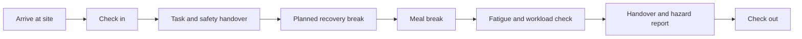
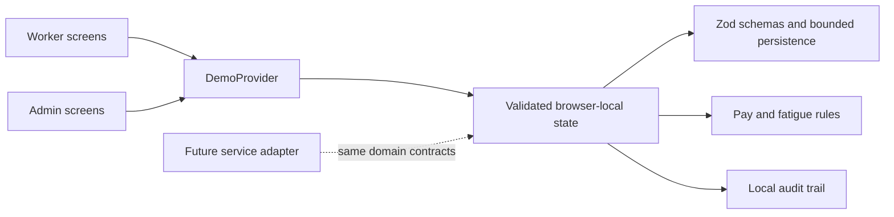

# FairShift

> A privacy-aware workforce clarity prototype that helps frontline workers understand their day and helps operations teams respond responsibly.

**Status:** Hackathon prototype · **Data:** Synthetic only · **Runtime:** Next.js 16 / React 19 / TypeScript

FairShift is a mobile-first web application for the moments that shape a frontline worker's day: arriving on site, understanding a shift, protecting rest, checking estimated pay, reporting a safety concern, and handing work over. A separate operations workspace turns the same demo scenario into actionable context without surfacing identities from anonymous reports.

The project is informed by the intent of **UN Sustainable Development Goal 8 — Decent Work and Economic Growth**. It demonstrates product direction and interaction design; it is not a payroll platform, safety case-management system, timekeeping system, or identity provider.

## Contents

- [What FairShift solves](#what-fairshift-solves)
- [Product walkthrough](#product-walkthrough)
- [Research-informed workday model](#research-informed-workday-model)
- [Accessibility and language support](#accessibility-and-language-support)
- [Architecture](#architecture)
- [Quick start](#quick-start)
- [Routes and demo access](#routes-and-demo-access)
- [Privacy, security, and prototype boundaries](#privacy-security-and-prototype-boundaries)
- [Security policy](#security-policy)
- [Quality checks](#quality-checks)
- [Container and Cloud Run deployment](#container-and-cloud-run-deployment)
- [Production-readiness plan](#production-readiness-plan)
- [Contributing](#contributing)

## What FairShift solves

Frontline workers frequently need direct answers under time pressure:

- Where do I need to be, and when does my shift begin?
- What should happen before I start work, during breaks, and at handover?
- What does my pay estimate include?
- Can I flag a concern without unnecessarily exposing myself?

Operations and safety teams need a complementary view:

- Which incidents need ownership or follow-up?
- Where may scheduling and rest patterns require attention?
- Which pay questions need a plain-language response?
- What was changed, by whom, and when in the demo scenario?

FairShift keeps those needs deliberately separate.

| Workspace | Primary users | Core outcome |
| --- | --- | --- |
| Worker app | Construction and support staff | A clear, accessible workday plan and safe routes to ask for help |
| Admin workspace | Operations, safety, and workforce teams | Privacy-aware context for responsible follow-up |

### Product principles

1. **Clarity before complexity.** Each screen leads with the most immediate next step.
2. **Agency without surveillance.** Workers can report concerns anonymously; admins do not receive anonymous reporter identities.
3. **Support, not punishment.** Fatigue and workforce signals guide scheduling and support decisions, not disciplinary scoring.
4. **Accessibility is a product feature.** Read-aloud, visible focus states, high-contrast affordances, reduced-motion support, and language selection are part of the main workflow.
5. **Be explicit about uncertainty.** Pay is labelled as an estimate; browser-local actions are never presented as verified payroll or centrally approved attendance.

## Product walkthrough

### Worker workspace

| Moment | FairShift surface | What the worker can do |
| --- | --- | --- |
| Before work | Dashboard and shift plan | See location, start time, supervisor, safety handover, and planned breaks |
| Arriving | Attendance action | Check in to the local demo scenario and receive confirmation |
| During work | Workday flow | Review planned recovery and meal breaks, task/fatigue check, and end-of-day handover |
| Need support | Safety and feedback | Submit a named or anonymous safety concern; share anonymous-by-default rest feedback |
| Pay clarity | Pay estimate | Review regular hours, overtime, allowances, deductions, and estimate status |
| Growth | Skill passport | View verified skills and skills currently in progress |
| Accessibility | Header and profile settings | Choose language and use opt-in read-aloud without granting microphone permission |

### Admin workspace

| Area | Purpose | Privacy boundary |
| --- | --- | --- |
| Workforce health | Review attendance, open cases, fatigue signals, pay queries, and sentiment | Uses a demo aggregate view |
| Worker directory | See illustrative site, role, attendance, skills, and support signals | Anonymous feedback and anonymous report identity do not appear in profiles |
| Safety command center | Assign a case owner, update status, and record corrective action | `reporterName` is removed before reports reach admin cards |
| Fair work insights | Understand overtime, rest, pay-clarity, and PPE signals | Signals are explanatory prompts, not automated decisions |
| Audit history | Inspect actions completed in the current browser profile | Local demo audit trail only |
| Workforce rules | View configurable prototype policies and voice-language settings | Not legal or contractual compliance automation |

## Research-informed workday model

FairShift treats a shift as a sequence of work-support moments rather than a clock-in/clock-out pair:



The prototype includes clear prompts for safety handover, recovery and meal time, workload/fatigue review, and handover. Its design rationale draws on:

- [NIOSH fatigue guidance](https://www.cdc.gov/niosh/topics/fatigue/default.html), which links nonstandard schedules, extended hours, task demands, and heat with reduced attention, reaction time, memory, and judgement.
- [NIOSH rest-break guidance](https://www.cdc.gov/niosh/work-hour-training-for-nurses/longhours/mod5/10.html), which discusses scheduling breaks with assignments and arranging coverage so workers can take them.
- [ILO working-time guidance](https://www.ilo.org/ilo-helpdesk-questions-and-answers-business-and-working-time), which describes rest and meal periods in the context of work demands, law, and collective agreements.

> **Important:** FairShift does not calculate legal entitlement to rest, overtime, or pay. Local law, contracts, collective agreements, and verified workplace policy must govern real decisions.

## Accessibility and language support

FairShift is designed for workers who may be on a busy site, using a small device, relying on a screen reader, or more comfortable hearing key information.

### Interaction and visual accessibility

- Responsive worker layouts from compact phone widths to desktop.
- A light system with semantic CSS tokens, high-contrast ink surfaces, violet action states, and warm yellow attention states.
- Visible keyboard focus, descriptive labels for icon controls, 44 px interaction targets for key touch controls, reduced-motion support, and a higher-contrast fallback.
- A skip link to the page's main content and semantic headings for assistive-technology navigation.
- Read-aloud is always optional, has a visible stop action, and never replaces written information.

### Voice access

The app uses the browser's standard [SpeechSynthesis API](https://developer.mozilla.org/en-US/docs/Web/API/SpeechSynthesis). It can speak worker shift, pay, safety, feedback, and profile content, plus admin priorities, safety cases, insights, audit activity, and policy information.

- Read-aloud does **not** request microphone access.
- Speech is initiated only after a person selects a read-aloud control.
- The selected locale is stored locally when browser storage is available.
- Exact voices depend on the voices installed in the user's browser or operating system.
- If browser speech synthesis is unavailable, the written content and existing screen-reader semantics remain available.

### Languages

The language picker exposes **32 voice locales**, including Arabic, Assamese, Bengali, Chinese (Simplified and Traditional), English (India and United States), Filipino, French, German, Gujarati, Hindi, Indonesian, Italian, Japanese, Kannada, Korean, Malayalam, Marathi, Nepali, Odia, Polish, Portuguese, Punjabi, Russian, Spanish, Tamil, Telugu, Urdu, and Vietnamese.

High-frequency worker controls and shift briefings are natively localised for Arabic, Bengali, Gujarati, Hindi, Kannada, Malayalam, Marathi, Punjabi, Tamil, Telugu, and Urdu. Arabic and Urdu activate right-to-left layout direction. Other voice locales use safe English UI copy while still requesting the chosen speech locale from the browser.

## Architecture

FairShift is intentionally a client-side prototype with a replaceable data boundary.



### Runtime model

- `DemoProvider` connects worker and admin interactions in **one browser profile**.
- Scenario state is written only to `sessionStorage`, is schema-validated and size-bounded before parsing, and expires after 30 minutes. It is cleared when the browser tab session ends.
- A worker safety report appears in the admin safety workspace in that same browser profile.
- Admin updates append to the local audit trail.
- Browser-local state is deliberately not synchronised between devices, browsers, accounts, or Cloud Run instances.

### Key domain safeguards

| Concern | Implementation in this prototype |
| --- | --- |
| Payroll arithmetic | Pay primitives use integer paise to avoid floating-point currency drift |
| Unsafe inputs | Strict Zod schemas validate persisted demo state and safety report inputs |
| Anonymous reporting | Admin rendering receives an identity-stripped report object |
| Incident closure | A resolution note is required before a case can be marked resolved |
| Headers | A request-specific nonce CSP, HSTS, anti-framing, MIME-sniffing, referrer, cross-origin, cache, and permissions controls |
| Browser privacy | Camera, geolocation, microphone, payment, screen capture, USB, sharing, and other unused capabilities are disabled through `Permissions-Policy` |

### Repository map

```text
app/                         Next.js route surfaces
  worker/[page]/             Worker dashboard, shift, pay, safety, feedback, skills, profile
  admin/[page]/              Operations, safety, insights, pay queries, audit, settings
components/                  Shared shells, state provider, accessibility tools, safety form
lib/                         Demo schemas, rules, security headers, seed data, unit tests
ENGINEERING_REPORT.md        Detailed implementation and production-adapter notes
Dockerfile                   Node 20 Alpine container build
```

## Technology

| Layer | Choice | Why it is here |
| --- | --- | --- |
| Framework | Next.js 16 App Router | Route-based product surfaces and production build pipeline |
| UI | React 19, CSS custom properties, Lucide | Responsive component UI with a consistent icon set |
| Type safety | TypeScript | Strict compile-time checks across worker, admin, and domain code |
| Validation | Zod | Boundary validation for persisted demo state and report updates |
| Tests | Vitest | Fast unit coverage for payroll, fatigue, privacy, security, and accessibility helpers |
| Deployment | Docker / Cloud Run compatible | A portable production-mode demo container |

## Quick start

### Prerequisites

- [Node.js](https://nodejs.org/) 22.12 or newer (Node 24 is used in CI and Docker)
- npm 10 or newer

### Install and run in development

```bash
git clone https://github.com/Ars6ad/PROMPT-WARS-EXE-2.git
cd PROMPT-WARS-EXE-2
npm ci
npm run dev
```

Open [http://localhost:3000](http://localhost:3000).

`npm ci` is recommended for a repeatable install from the committed lockfile. `npm install` also works when intentionally updating dependencies.

### Run the production build locally

```bash
npm run build
npm run start -- -p 3001
```

Open [http://localhost:3001](http://localhost:3001). The start command binds to `0.0.0.0` and honours the `PORT` environment variable when it is provided.

### Available scripts

| Command | Description |
| --- | --- |
| `npm run dev` | Start the Next.js development server |
| `npm run check` | Run strict TypeScript validation without emitting files |
| `npm run test` | Run the Vitest unit suite |
| `npm run build` | Create an optimised Next.js production build |
| `npm run start` | Serve the production build |
| `npm run quality` | Run type checks, tests, and a production build in sequence |

## Routes and demo access

### Demo accounts

The sign-in page is a role-selection demo. It does not verify passwords, create accounts, or provide authentication.

| Role | Demo identity | Entry point |
| --- | --- | --- |
| Worker | Asha Kumar, Construction Helper | `/login` → Worker |
| Worker | Ravi Kumar, Hospital Attendant | Seeded scenario identity |
| Admin | Priya Sharma, Operations Manager | `/login` → Admin |

All names, sites, amounts, incidents, and worker records are fictional.

### Route reference

| Route | Description |
| --- | --- |
| `/` | Product landing page and role entry points |
| `/login` | Worker or admin demo role selection |
| `/about` | Product framing and principles |
| `/privacy` | Prototype privacy disclosure |
| `/worker/dashboard` | Daily plan, attendance, pay snapshot, rest prompt, and quick actions |
| `/worker/shift` | Shift timeline and check-in/check-out flow |
| `/worker/pay` | Explained estimated-pay breakdown |
| `/worker/safety` | Safety report submission and status list |
| `/worker/feedback` | Anonymous-by-default feedback flow |
| `/worker/skills` | Portable skill passport |
| `/worker/profile` | Worker profile and accessibility/language preference |
| `/admin/dashboard` | Workforce health overview |
| `/admin/workers` | Illustrative worker directory |
| `/admin/safety` | Privacy-aware safety follow-up |
| `/admin/insights` | Workforce support signals |
| `/admin/pay-queries` | Illustrative pay-query queue |
| `/admin/audit` | Browser-local audit history |
| `/admin/settings` | Prototype workplace rules and manager accessibility preference |

## Privacy, security, and prototype boundaries

### What is implemented

- `proxy.ts` generates a fresh CSP nonce for every document response; Next.js applies it to its framework scripts. The policy blocks inline script attributes, untrusted script origins, framing, objects, cross-origin connections, and form posts outside the app.
- `next.config.ts` applies HSTS, cross-origin isolation headers, MIME-sniffing prevention, referrer policy, anti-framing, restrictive browser permissions, and route-specific no-store/no-index headers.
- Workspace and sign-in responses use `Cache-Control: no-store`; worker and admin workspace metadata is also marked non-indexable.
- The browser demo has no embedded production credentials, payment details, biometrics, or real worker data.
- `.env` files and build output are ignored by Git.
- Demo state is validated with strict Zod schemas before use, bound to one browser tab, capped in size, and given a short client-side expiry. It is not a session token or an authority source.
- The admin safety view removes the reporter identity field before rendering any report.
- Visual labels explicitly distinguish estimated pay, local actions, and demo-only behaviour.
- GitHub Actions runs type checks, unit tests, a production build, and a production-dependency audit on each push and pull request. Dependabot checks npm packages and GitHub Actions weekly.

### Security model and review protocol

The controls above follow a defence-in-depth approach informed by the [OWASP Content Security Policy Cheat Sheet](https://cheatsheetseries.owasp.org/cheatsheets/Content_Security_Policy_Cheat_Sheet.html), [OWASP HTTP Headers Cheat Sheet](https://cheatsheetseries.owasp.org/cheatsheets/HTTP_Headers_Cheat_Sheet.html), and [OWASP Session Management Cheat Sheet](https://cheatsheetseries.owasp.org/cheatsheets/Session_Management_Cheat_Sheet.html). They reduce browser-side exposure in this prototype; they do not add identity, tenancy, or tamper-proof records.

| Layer | Current control | Verification |
| --- | --- | --- |
| Script injection | Per-request CSP nonce and `script-src-attr 'none'` | Unit tests and manual response-header check |
| Clickjacking and cross-origin leakage | `frame-ancestors`, `X-Frame-Options`, COOP, COEP, CORP, and `Origin-Agent-Cluster` | Response-header check |
| Transport and browser features | HSTS on HTTPS deployments; restrictive `Permissions-Policy` | HTTPS deployment check |
| Shared-device privacy | `no-store` on demo and workspace routes; no-index metadata/header | Response-header check |
| Demo input and privacy | Strict bounded schemas; identity stripping before admin rendering | Unit tests |
| Supply chain | Pinned lockfile, production `npm audit` gate, Dependabot, and CI | `npm audit --omit=dev --audit-level=high` |

The CSP retains `style-src 'unsafe-inline'` because the current component system uses React inline styles. That allowance does not permit inline JavaScript. Replacing it with a strict style nonce is a deliberate future refactor, to be tested screen by screen rather than added as an unverified claim.

### What is deliberately not claimed

| Area | Prototype behaviour | Required before real use |
| --- | --- | --- |
| Authentication | Demo role selection | Verified account lifecycle, MFA/passkeys, recovery, and HTTP-only secure sessions |
| Authorisation | Client-side route presentation | Server-enforced organisation isolation and role-based access control on every read and mutation |
| Attendance | Browser-local check-in/out | Trusted server timestamps, idempotency, signed QR records, and offline sync |
| Payroll | Illustrative estimate | Approved rules engine, integrations, human review, and compliant records |
| Incidents | Browser-local reports | Encrypted storage, retention policy, attachments, escalation paths, and audit retention |
| Voice | Browser speech synthesis | Accessibility testing with real users and device/browser support policy |
| Deployment | Container-ready demo | Threat modelling, secrets management, monitoring, rate limiting, CSRF protection, backup/retention controls, and incident response |

> **Do not enter real personal, payroll, health, biometric, safety-incident, or employment data into this project.**

## Quality checks

Run the complete verification suite before sharing a build:

```bash
npm run quality
```

The suite runs the following gates:

| Check | What it verifies |
| --- | --- |
| `npm run check` | Strict TypeScript correctness |
| `npm run test` | Pay arithmetic, fatigue rules, anonymous-report handling, security headers, and voice/language helper behaviour |
| `npm run build` | Production compilation, route generation, and Next.js build integrity |

For a manual smoke test, start the production build and visit `/worker/dashboard`, `/worker/shift`, `/worker/safety`, `/admin/dashboard`, `/admin/safety`, and `/admin/settings`. Confirm the worker/admin separation, try a local safety report, change the voice locale, and ensure the report is visible in the admin safety view without an anonymous reporter identity.

## Container and Cloud Run deployment

The repository includes a Node 24 Alpine `Dockerfile` that builds and serves the application in production mode on port `8080`.

### Build and run with Docker

```bash
docker build -t fairshift .
docker run --rm -p 8080:8080 fairshift
```

Open [http://localhost:8080](http://localhost:8080).

### Cloud Run example

```bash
gcloud builds submit --tag gcr.io/PROJECT_ID/fairshift
gcloud run deploy fairshift \
  --image gcr.io/PROJECT_ID/fairshift \
  --platform managed \
  --region asia-south1 \
  --allow-unauthenticated
```

Replace `PROJECT_ID`, select the appropriate region and ingress policy, and review access requirements for the target environment. This deployment serves the prototype UI only; it does not add authentication, a shared database, or safeguards required for real worker data.

## Production-readiness plan

FairShift's client-side state boundary is intentionally replaceable. A real implementation should evolve in this order:

1. Introduce an authenticated service layer with organisation isolation and role-based access control.
2. Move all mutations and role checks to server-side route handlers; maintain explicit domain contracts.
3. Add a migration-managed database for memberships, shifts, attendance events, pay rules, safety cases, feedback, credentials, and audit records.
4. Adopt trusted timestamps, idempotency keys, signed QR payloads, encrypted attachment storage, rate limits, and retriable queues.
5. Integrate approved payroll and policy sources with human review for exceptions.
6. Run end-to-end, accessibility, performance, privacy, and security testing with representative workers before accepting real data.

See [ENGINEERING_REPORT.md](ENGINEERING_REPORT.md) for implementation detail and an adapter-oriented architecture note.

## Security policy

See [SECURITY.md](SECURITY.md) for the reporting process, scope, and production security requirements. Do not report a suspected vulnerability in a public GitHub issue and never use real workforce information in a proof of concept.

## Contributing

FairShift is currently a prototype, but contributions are welcome when they preserve its core promise: **workers receive clarity and agency; administrators receive actionable context without unnecessary exposure of personal information.**

Before opening a pull request:

1. Keep all examples and fixtures synthetic.
2. Preserve keyboard access, visible focus, responsive layouts, and reduced-motion support.
3. Do not weaken anonymous-report identity stripping or prototype disclosures.
4. Add or update focused tests when changing `lib/` domain logic or accessibility helpers.
5. Run `npm run quality` and describe the user-facing effect in the pull request.

For substantial product or architecture changes, open an issue first so the intended privacy, safety, and accessibility implications can be discussed.

## Documentation and support

- [Engineering report](ENGINEERING_REPORT.md) — implementation notes, route inventory, and production-adapter outline.
- [Security policy](SECURITY.md) — vulnerability reporting and security scope.
- [Submission checklist](SUBMISSION_CHECKLIST.md) — hackathon delivery checklist.
- [LinkedIn post draft](LINKEDIN_POST_DRAFT.md) — project announcement draft.

Use GitHub Issues for non-sensitive bug reports and feature ideas. Do not include private workforce information, credentials, or security-sensitive reproduction details in a public issue.

## License

No licence has been selected yet. Until a licence is added, standard copyright restrictions apply; do not assume permission to redistribute, modify, or use this code outside the repository's applicable terms.
